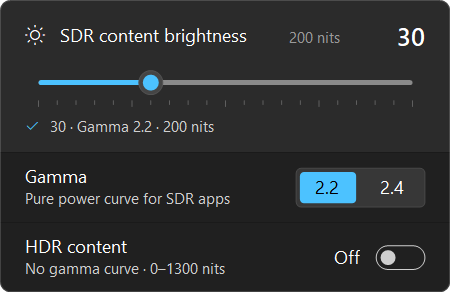
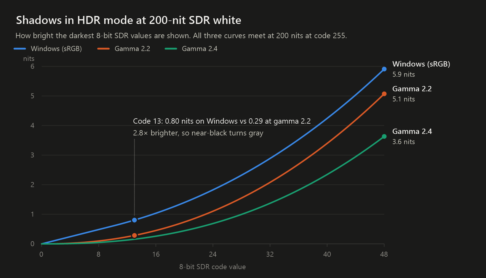
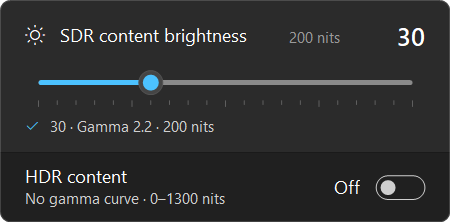
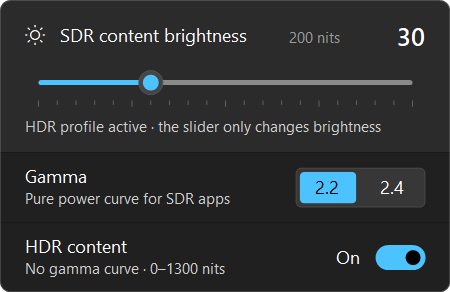
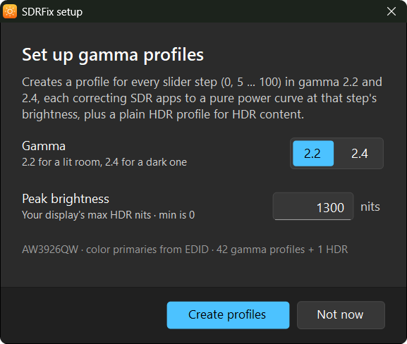
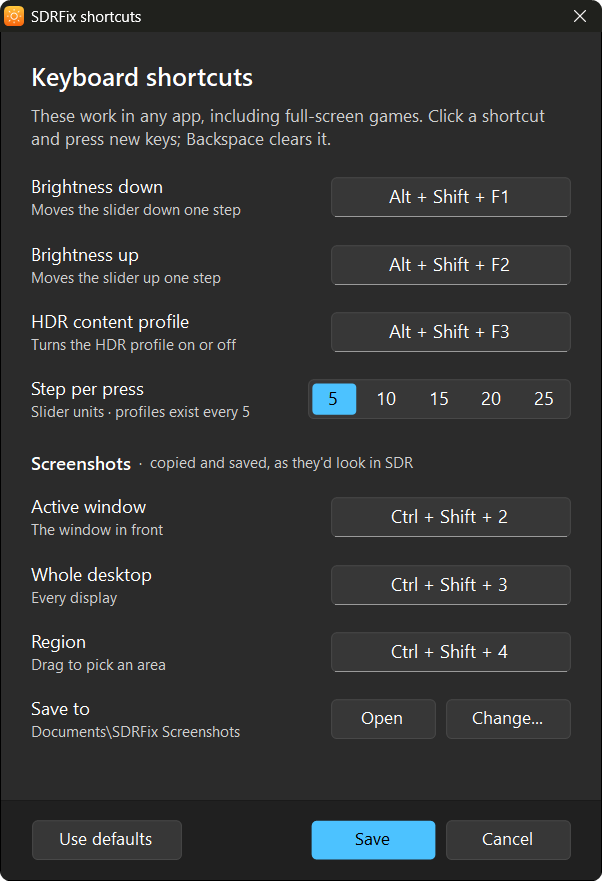
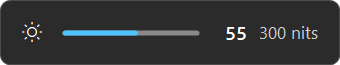
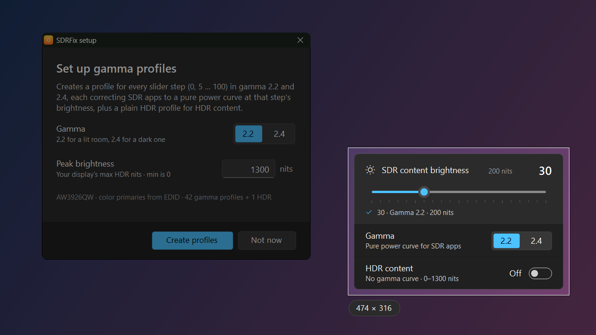

# SDRFix

**Correct gamma for SDR content in Windows HDR mode, at every SDR brightness level.**

When HDR is on, Windows makes SDR apps, the desktop, videos and games look washed out: blacks
turn gray and shadows lose depth. SDRFix is a small tray app that fixes this. It gives Windows
a matching gamma-correction profile for every position of the *SDR content brightness* slider
and switches between them for you. It also takes [screenshots](#screenshots) that come out
right with HDR on.

<p align="center"></p>

**[Download SDRFix.exe](https://github.com/mcdeip/SDRFix/releases/latest/download/SDRFix.exe)**.
It's a single portable file with no installer and needs no admin rights.

---

## Why SDR looks wrong in HDR mode

In HDR mode Windows has to translate every SDR pixel into an absolute brightness. It does that
with the **piecewise sRGB curve**: a short straight line near black, then a 2.4 power curve,
scaled so that white lands on your *SDR content brightness* setting.

Almost all SDR content is made and checked on displays that follow a **pure power curve**:
about gamma 2.2 for PC, web and game content, and gamma 2.4 (BT.1886) for films and TV graded
in a dark room. The two curves agree in the bright half of the range, but they split apart in
the shadows. The straight segment of the sRGB curve makes near-black much brighter than the
content was graded for:

<p align="center"></p>

| SDR code value | Windows (sRGB) | Gamma 2.2 | Gamma 2.4 | Windows vs 2.2 |
|---:|---:|---:|---:|---:|
| 5 (2%) | 0.30 nits | 0.035 nits | 0.016 nits | 8.7× brighter |
| 13 (5%) | 0.80 nits | 0.29 nits | 0.16 nits | 2.8× brighter |
| 26 (10%) | 2.07 nits | 1.32 nits | 0.83 nits | 1.6× brighter |
| 51 (20%) | 6.6 nits | 5.8 nits | 4.2 nits | 1.1× brighter |
| 128 (50%) | 43 nits | 44 nits | 38 nits | about the same |
| 255 (100%) | 200 nits | 200 nits | 200 nits | the same |

*Values at 200-nit SDR white (slider at 30). The ratios are the same at every brightness level.*

On an OLED or a mini-LED display with deep blacks, this raised floor is easy to see. Dark
scenes look foggy, letterboxing looks gray, and dark UI themes lose contrast.

## How SDRFix fixes it

Windows supports a special kind of color profile for HDR mode: an ICC profile with a Microsoft
**MHC2** tag. This tag holds a lookup table that Windows' display pipeline applies to the whole
screen. SDRFix uses it to turn Windows' sRGB decode back into a pure power curve:

- **One profile per slider step.** The right correction depends on where SDR white sits. A
  curve built for 200 nits is the wrong shape at 300 nits. Setup creates a profile for every
  step from 0 to 100 (80 to 480 nits), for both gamma 2.2 and gamma 2.4.
- **Switched automatically.** Whenever the brightness changes, from the slider, a shortcut or
  the tray menu, SDRFix sets Windows' SDR brightness *and* makes the matching profile the
  display's default. They never get out of step.
- **Only the range below SDR white changes.** The correction is strongest near black, fades out
  smoothly towards SDR white, and leaves everything brighter than SDR white unchanged. Windows
  applies it to everything on screen, so the shadows of HDR games and films get it too. One
  shortcut switches to a plain [HDR content profile](#hdr-content-profile) for those.
- **The proven curve.** The lookup tables match the "Pure Power" profiles from
  [ColorControl](https://github.com/Maassoft/ColorControl) value for value. All 1024 entries
  were checked against ColorControl's profiles for the same display. The profiles are also
  tagged with your display's own color primaries, read from its EDID.
- **Nothing runs per frame.** Windows applies the profile in its display pipeline, so it works
  in every app, browser, video player and game (windowed or full-screen). Nothing is injected,
  and there's no performance cost. SDRFix itself only wakes up when you change something.

## Compared with other fixes

There are two common system-wide fixes. One is a **single gamma profile** installed once: a
generic download such as
[win11hdr-srgb-to-gamma2.2-icm](https://github.com/dylanraga/win11hdr-srgb-to-gamma2.2-icm),
or one made for your display with ColorControl. The other is a **DWM hook** such as
[dwm_lut](https://github.com/ledoge/dwm_lut), which injects into `dwm.exe` and runs a 3D LUT
over the desktop.

| | SDRFix | Single gamma profile | DWM hook with a 3D LUT |
|---|---|---|---|
| **How it's applied** | Windows' own MHC2 color profiles | Windows' own MHC2 color profiles | Code injected into `dwm.exe`, hooking its rendering |
| **Matches your SDR brightness** | Every slider step from 0 to 100, switched automatically | Right at one level. The generic set covers 100, 200, 300 and 400 nits, so you pick the closest and swap it when you move the slider. | Right at the level the LUT was built for. Build and load a new LUT when you change it. |
| **HDR games and video** | Shadows below SDR white are corrected too. One shortcut switches to a plain HDR profile and back. | Shadows below SDR white are corrected too. Switch profiles by hand in Color Management. | The LUT runs on the final output, so HDR content goes through it too. Disable it by hand. |
| **Gamma** | 2.2 or 2.4, switch any time | Whatever the profile was made for (the generic set is 2.2) | Whatever the LUT was made for |
| **Performance** | No cost. Windows applies the profile in its display pipeline. | No cost (same mechanism) | Turns off DirectFlip and MPO on that monitor so every window goes through DWM. Exclusive full-screen games aren't covered. |
| **Windows updates** | Uses documented Windows features | Uses documented Windows features | The hook depends on DWM internals. The original tool stopped working with Windows 11 22H2 and now lives on in a fork. |
| **Full color calibration** | No. It corrects gamma only. | No. It corrects gamma only. | Yes. A measured 3D LUT can also correct gamut and grayscale. |

SDRFix uses the same mechanism as a single gamma profile. Nothing is patched or injected, and
there's no performance cost. What it fixes is that mechanism's weakness: a single profile is
only right at one brightness level, and switching profiles by hand is a chore. It also makes the
profiles for your display, using its primaries and peak brightness, rather than generic ones. If
you need full measured calibration, a 3D LUT does more than SDRFix can.

---

## Features

### Brightness slider

Left-click the tray icon to open the slider. It works like Windows' own *SDR content brightness*
slider, but it shows the resulting SDR white level in nits and snaps to steps of 5, one per
profile. Brightness follows the slider live while you drag, and the matching profile is applied
as soon as you let go.

- **Mouse wheel** or **arrow keys**: one step. **Page Up / Page Down**: five steps. **Home / End**:
  0 or 100.
- **Enter** applies and closes. **Esc** closes.
- The status line confirms which profile is active. If something else changed the brightness, for
  example Windows Settings set an in-between value like 33, the status line says so. Click it to
  snap back to a matching step.

### Gamma 2.2 or 2.4

Choose the curve in the slider, press **G** while the slider is open, or use **Gamma** in the
tray menu. Use **2.2** for most PC content and a lit room, and **2.4** for films in a dark room.
Both sets are created by setup, so switching is instant.

If you never switch, hide the toggle with *Gamma → Show toggle in slider* in the tray menu:

<p align="center"></p>

### HDR content profile

The gamma profiles change everything below SDR white, HDR content included, so an HDR game's
shadows would come out darker than they were graded. At 200-nit SDR white with gamma 2.2, a
0.80-nit shadow is shown at about 0.29 nits. Mid-tones move by 1–2%, and nothing at or above
200 nits changes. For HDR games and HDR video you don't want that. Turn on **HDR content** in
the slider (or press **Space** in the slider, or use the shortcut) to switch to a plain HDR
profile with no gamma curve. It only declares your display's brightness range, from 0 to the
peak you entered in setup. The brightness slider still works while it's on. Turn it off again
to go back to the gamma profile for the current step.

<p align="center"></p>

Windows reports this peak to HDR games and apps as the display's maximum brightness, just like a
profile from the Windows HDR Calibration app.

### Setup

Setup runs on first launch, and you can run it again any time from **Set up gamma profiles…**
in the tray menu. Pick the gamma to start with and enter your display's peak HDR brightness.
Setup then creates all 43 profiles in a second or two: 21 steps × 2 gammas, plus the HDR
profile. Running it again (say, with a different peak) overwrites them in place, and SDRFix
re-applies the active one.

<p align="center"></p>

For the peak, use your display's real HDR peak, for example from a review, your display's
specifications, or the Windows HDR Calibration app.

### Keyboard shortcuts

Change SDR brightness from inside a full-screen game without alt-tabbing. These shortcuts work
in any app:

| Action | Default |
|---|---|
| Brightness down | `Alt` + `Shift` + `F1` |
| Brightness up | `Alt` + `Shift` + `F2` |
| HDR content profile on/off | `Alt` + `Shift` + `F3` |
| [Screenshot](#screenshots) of the active window | `Ctrl` + `Shift` + `2` |
| Screenshot of the whole desktop | `Ctrl` + `Shift` + `3` |
| Screenshot of a region | `Ctrl` + `Shift` + `4` |

To change them, open **Keyboard shortcuts…** in the tray menu, click a shortcut and press the new
keys. **Backspace** clears a shortcut. Keys that type something (letters, digits, arrows) need at
least one modifier, but function keys and media keys can be used alone. **Step per press** sets
how far each press moves the slider: 5 (one profile step, the default), 10, 15, 20 or 25.

<p align="center"></p>

If another app already owns a shortcut, Windows won't give it to SDRFix. The tray menu then shows
*Keyboard shortcuts… (1 unavailable)* and the window tells you which one, so you can pick
another. SDRFix tries again each time you open the tray menu.

Global shortcuts also take priority over apps' own. For example, while SDRFix holds
`Ctrl` + `Shift` + `2`–`4`, Excel's matching number-format shortcuts don't reach Excel.

### On-screen indicator

Shortcut presses show a small indicator at the bottom of the screen, like Windows' volume
flyout. It never takes focus and lets clicks pass through, so your game keeps running
undisturbed. Quick repeated presses are combined, so the profile is applied once when you stop.

<p align="center"></p>

### Screenshots

With HDR on, Windows composes the desktop in 16-bit floating point. In that format 1.0 means
80 nits, and SDR content is scaled up to your SDR white, for example to 2.5 at slider 30. A
screenshot tool has to squeeze this into an ordinary 8-bit image:
- A tool that treats 1.0 as white cuts off everything above 80 nits, so the shot blows out.
- An 8-bit image has no room above SDR white, so HDR highlights clip to flat white, even in
  tools that get SDR content right.

SDRFix reads the 16-bit desktop directly, using DXGI desktop duplication. It divides by SDR white
and re-encodes with the same sRGB curve Windows decoded it with:

- **SDR content comes back pixel-exact.** You get the values the app drew. This was checked
  with a strip of test colors from black to white.
- **HDR content is tone-mapped, not clipped.** If the captured area contains anything brighter
  than SDR white, the highlights roll off smoothly (BT.2390 tone mapping) instead of turning flat
  white. The indicator then says *HDR tone-mapped*.
- **Nothing changes on screen.** SDRFix doesn't switch brightness or profiles to take a shot.
  The gamma profiles aren't part of the capture either: screenshots hold what apps drew, so they
  look right on anyone else's screen.

| Shortcut | Captures |
|---|---|
| `Ctrl` + `Shift` + `2` | The active window (or the display under the pointer, if that's the desktop or taskbar) |
| `Ctrl` + `Shift` + `3` | Every display, as one image |
| `Ctrl` + `Shift` + `4` | A region: drag on the frozen screen. **Esc** or right-click cancels. |

The image goes to the clipboard as both a bitmap and a PNG, ready to paste. It's also saved as
a PNG file, named like `Screenshot 2026-11-04 142233.png`, in `Documents\SDRFix Screenshots`.
To save somewhere else, open **Keyboard shortcuts…** and choose **Change…** next to *Save to*.
**Open screenshot folder** in the tray menu takes you there. The mouse pointer isn't included. These shortcuts work with HDR off too, as ordinary screenshots. Rotated (portrait)
displays aren't supported yet.

<p align="center"></p>

### Tray menu

Right-click the tray icon:

| Item | What it does |
|---|---|
| **Open slider** | Same as left-clicking the icon |
| **SDR brightness** | Every step with its nits value, for example *30 · 200 nits*. Steps without a profile are marked. |
| **Gamma** | *Show toggle in slider*, plus 2.2 and 2.4 |
| **HDR content profile** | On/off, with its shortcut |
| **Display** | Shown only with more than one display. Picks which one SDRFix controls, and marks displays with HDR off or without HDR. |
| **Set up gamma profiles…** | Runs setup again |
| **Keyboard shortcuts…** | Changes the shortcuts, the step per press and the screenshot folder |
| **Open screenshot folder** | Opens the folder screenshots are saved to |
| **Display settings…** | Opens Windows' display settings (turn HDR on there) |
| **Start with Windows** | Starts SDRFix when you sign in |
| **Exit** | Quits. The current brightness and profile stay as they are. |

The tray tooltip shows the current state, for example *SDR brightness 30 (200 nits) · gamma 2.2*.
SDRFix follows Windows' light or dark theme.

### Works with your own profiles too

If you'd rather make profiles yourself (with ColorControl, for example), SDRFix will use those
for displays where setup hasn't been run. Name each profile after its slider step, like `40.icm`,
or give it a description that starts with the number, like *40 (Pure Power 2.2)*. A profile named
`HDR.icc`, or described as *HDR*, becomes the HDR content profile.

---

## SDR brightness and nits

Windows' *SDR content brightness* slider maps to SDR white as **nits = 80 + 4 × slider**:

| Slider | SDR white | Slider | SDR white | Slider | SDR white |
|---:|---:|---:|---:|---:|---:|
| 0 | 80 nits | 35 | 220 nits | 70 | 360 nits |
| 5 | 100 nits | 40 | 240 nits | 75 | 380 nits |
| 10 | 120 nits | 45 | 260 nits | 80 | 400 nits |
| 15 | 140 nits | 50 | 280 nits | 85 | 420 nits |
| 20 | 160 nits | 55 | 300 nits | 90 | 440 nits |
| 25 | 180 nits | 60 | 320 nits | 95 | 460 nits |
| 30 | 200 nits | 65 | 340 nits | 100 | 480 nits |

## Requirements

- Windows 11 with an HDR display and HDR turned on (*Settings → System → Display → Use HDR*).
  It's developed and tested on Windows 11. Windows 10 is untested.
- .NET Framework 4.x, which is already part of Windows 10 and 11.

The exe isn't code-signed, so SmartScreen may warn the first time you run it. Choose
*More info → Run anyway*, or build it yourself from source (see below).

## Files and settings

- **Profiles:** `C:\Windows\System32\spool\drivers\color\SdrBrightness-<display model>-<gamma>-<step>.icm`,
  plus `SdrBrightness-<display model>-HDR.icm`. Profiles are named per display model, so each
  display gets its own set.
- **Screenshots:** `Documents\SDRFix Screenshots`, unless you choose another folder
- **Settings:** `HKEY_CURRENT_USER\Software\SdrBrightness`
- **Start with Windows:** the `SdrBrightness` value under
  `HKEY_CURRENT_USER\Software\Microsoft\Windows\CurrentVersion\Run`

### Uninstalling

1. Untick **Start with Windows** and choose **Exit**.
2. Delete `SDRFix.exe`.
3. Optional: to remove the profiles, open *Color Management* (`colorcpl`), and on the *Devices*
   tab select your display and remove the `SdrBrightness-…` profiles. Then delete the files from
   the folder above and the settings key.

## Building from source

No SDK needed. Windows already ships the C# compiler that SDRFix is built with.

```bat
build.cmd
```

This produces `SDRFix.exe` next to the script. `tools\GammaChart.cs` draws the chart in this
README.

## Troubleshooting

- **A shortcut doesn't work.** Another app may own it. The NVIDIA App overlay, for example, uses
  `Alt` + `F1`, `Alt` + `F2` and others. If another screenshot tool such as ShareX is set to
  `Ctrl` + `Shift` + `2`–`4`, remove those bindings there. Or choose different shortcuts in
  **Keyboard shortcuts…**.
- **"HDR is off".** SDRFix only works in HDR mode. Turn HDR on in **Display settings…**.
- **"Windows is set to 33".** Windows Settings (or another app) set a value between steps. Click
  the status line to snap to the nearest step.
- **"No profile for 35".** There are no profiles for this display and gamma yet. Run
  **Set up gamma profiles…**.
- **Colors look off after changing the peak in setup.** Toggle the **HDR content profile** on and
  off once, so Windows reloads the profile.

## Credits

- The correction curve follows [ColorControl](https://github.com/Maassoft/ColorControl) by
  Maassoft and its "Pure Power" SDR transfer function.
- MHC2 research by [dantmnf](https://github.com/dantmnf/MHC2), which made HDR-mode calibration
  profiles on Windows practical.

## License

[MIT](LICENSE)
